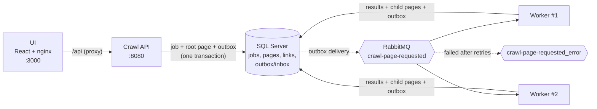

# Job-Based Web Crawler

Submit a URL, and the system crawls the site up to a maximum depth, counts the outgoing links of each page, computes
its **domain link ratio** (internal links / all links) and shows the result as a tree.

- **Crawl API**: ASP.NET Core 8, EF Core 8, SQL Server 2022.
- **Messaging**: RabbitMQ via MassTransit 8.4.1, with the EF Core transactional outbox and inbox.
- **Crawl Worker**: .NET 8, AngleSharp, `Microsoft.Extensions.Http.Resilience`. Runs as 2 replicas.
- **UI**: React 18 + Vite + TypeScript, served by nginx.

More detail: [Architecture](docs/ARCHITECTURE.md) · [Decisions (ADRs)](docs/DECISIONS.md) ·
[Current status](docs/CURRENT_STATUS.md) · [Troubleshooting](docs/TROUBLESHOOTING.md)

## Architecture



Each page is one message. A worker fetches the page, stores its links, inserts new internal pages (within depth and
page limits) and publishes one message per new page, all in one database transaction. The job is `Completed` when no
page is still `Queued`. See [docs/ARCHITECTURE.md](docs/ARCHITECTURE.md).

## How to run locally

### Required: Docker (full stack)

Prerequisite: Docker Desktop (or Docker Engine + Compose v2).

```bash
cp .env.example .env
```

```bash
docker compose up --build
```

| What | URL |
|---|---|
| UI | http://localhost:3000 |
| API + Swagger | http://localhost:8080/swagger |
| RabbitMQ management | http://localhost:15672 (user/password from `.env`) |

- The API applies database migrations on startup; the workers start after the API is healthy.
- **Port conflicts:** set `SQL_PORT`, `RABBITMQ_PORT`, `RABBITMQ_UI_PORT`, `API_PORT` or `WEB_PORT` in `.env`.
- **Behind a TLS-intercepting proxy or filter** (corporate proxy, NetFree): HTTPS pages fail in the containers with
  `SecureConnectionError`. Put the proxy's root CA as PEM `*.crt` files in `certs/` and run
  `docker compose build api worker`. See [certs/README.md](certs/README.md).
- Stop with `docker compose down` (add `-v` to delete the database and broker volumes).

### Optional: run from source

Prerequisites: .NET 8 SDK, Node 20+, Docker (for SQL Server and RabbitMQ).

1. Start only the infrastructure: `docker compose up -d sqlserver rabbitmq`
2. Set the shared user secrets once (API and Worker use the same store, `alteva-crawler-dev`):

   ```bash
   dotnet user-secrets set "ConnectionStrings:Crawler" "Server=localhost,1433;Database=Crawler;User Id=sa;Password=<SA_PASSWORD>;TrustServerCertificate=true" --project src/Crawler.Api
   ```

   ```bash
   dotnet user-secrets set "RabbitMq:Username" "<RABBITMQ_USER>" --project src/Crawler.Api
   ```

   ```bash
   dotnet user-secrets set "RabbitMq:Password" "<RABBITMQ_PASSWORD>" --project src/Crawler.Api
   ```

   Without secrets, Development settings fall back to LocalDB and `guest`/`guest`.
3. Run the API (http://localhost:5080/swagger, migrates the database in Development): `dotnet run --project src/Crawler.Api`
4. Run the Worker (health on http://localhost:5090): `dotnet run --project src/Crawler.Worker`
5. Run the UI (http://localhost:5173, proxies `/api` to :5080): `cd web && npm ci && npm run dev`

### Tests

```bash
dotnet test
```

- `tests/Crawler.UnitTests` (64): URL normalization (relative links, fragments, ports, schemes), Domain Link Ratio,
  link analysis, HTML link extraction, job transition rules. No dependencies.
- `tests/Crawler.IntegrationTests` (13): real SQL Server via Testcontainers, the MassTransit in-memory test harness
  instead of RabbitMQ, and **local HTML fixtures** (`Fixtures/site`) served by a fake HTTP handler instead of the network.
  **Needs Docker running.**
  - Worker pipeline: full crawl (expected pages, edges, ratios, depth limit, `<base href>`, PDF skipped, 404 failed),
    the same message delivered 3× concurrently and redelivered after completion (no duplicate rows), max pages,
    max depth 0, failed root page fails the job, canceled job is not crawled, poison message not retried + `Fault` raised.
  - API: create job (job, root page and first message via the outbox, CorrelationId = JobId), validation errors,
    tree 409/404, cancel 204 then 409, paginated history.
- UI: `npm run lint` and `npm run build` in `web/`.
- **CI** ([.github/workflows/ci.yml](.github/workflows/ci.yml)): .NET build + all tests, web lint + build, and
  `docker compose build`, on every push and pull request.

## API

Base path `/api/jobs`. JSON, enums as strings, UTC timestamps. All errors are `application/problem+json`.

| Method | Path | Result |
|---|---|---|
| `POST` | `/api/jobs` | Body `{ "url": "https://example.com", "maxDepth": 2 }` (`maxDepth` optional). **202** + `Location` + `{ jobId }`. **400** validation errors. **429** above 10 creations/min per client IP. |
| `GET` | `/api/jobs/{jobId}` | Job (status, limits, timestamps, failure reason) + `pageCounts { total, queued, done, skipped, failed }`. **404** if unknown. Polled by the UI. |
| `GET` | `/api/jobs/{jobId}/tree` | Page tree with link counts and `domainLinkRatio` per page. **409** until the job is `Completed`. |
| `GET` | `/api/jobs/{jobId}/pages/{pageId}/links` | Stored outgoing links of one page: `[{ url, isInternal }]`. |
| `GET` | `/api/jobs?page=1&pageSize=20` | History, newest first: `{ items, page, pageSize, totalCount }`. `pageSize` 1–100. |
| `POST` | `/api/jobs/{jobId}/cancel` | **204** canceled. **409** if the job already finished. |
| `GET` | `/health/live`, `/health/ready` | Liveness (process up) and readiness (database + RabbitMQ). Same on the Worker. |

## Crawling rules

| Rule | Behavior |
|---|---|
| URL normalization | Absolute http(s) only; fragment and user-info removed; scheme and host lower-cased; default port removed; dot-segments resolved; empty path → `/`. Path and query are kept as-is (case- and order-sensitive). |
| Ignored links | Non-http(s) schemes: `mailto:`, `tel:`, `javascript:`, `data:`, `ftp:`, … They are not counted. |
| Links of a page | `<a href>` and `<area href>`, resolved against `<base href>` or the final URL after redirects. **Distinct** normalized URLs; links to the page itself (`#top`, `./`) are excluded. |
| Internal link | Same host as the job's start URL, exact and case-insensitive (`www.example.com` ≠ `example.com`). |
| What is crawled | Only internal links. External links are stored and counted but never fetched. |
| Content | HTML only (`text/html`, `application/xhtml+xml`). Responses over **2 MB** are skipped. |
| Depth | Root is depth 0. `maxDepth` default **2**, allowed **0–5**. |
| Page budget | At most **200 pages** per job (including the root). |
| Stored edges | Up to 1,000 links stored per page; counts and ratio always use all links. |
| Timeouts | 10 s per attempt, 45 s total per page (including retries and reading the body). Up to 5 redirects. |
| Page statuses | `Done` (HTML parsed), `Skipped` (not HTML, too large, redirect not followed), `Failed` (HTTP error, network error, timeout). |
| Job statuses | `Pending` → `Running` → `Completed`; `Failed` if the root page fails or is not HTML; `Canceled` by the user. |

Limits are config defaults (`CrawlJobs`, `Crawler` sections) and are saved on each job when it is created.

## Message schema

```csharp
public sealed record CrawlPageRequested(Guid JobId, long PageId);
```

- The message only identifies a page row. URL, depth and status are read from the database (single source of truth).
- Sent in the standard MassTransit JSON envelope (`messageId`, `correlationId`, `messageType`, `message`, …).
  `CorrelationId` = `JobId`, so all logs of a job can be grouped.

| Queue / exchange | Purpose |
|---|---|
| `crawl-page-requested` | Page work queue, consumed by all Worker replicas (competing consumers). |
| `crawl-page-requested_error` | Dead-letter queue for page messages that failed. |
| `crawl-page-faults` | Receives `Fault<CrawlPageRequested>` and marks the page `Failed`. |

## Idempotency

Messages are delivered **at least once**, and two replicas can receive the same message. Protection, in layers:

1. **Conditional page update:** inside the consumer transaction, the worker takes an `UPDLOCK` on the job row, then
   updates the page `WHERE Status = 'Queued'`. Only the first delivery changes a row; later ones write nothing.
2. **Unique indexes** as a backstop: `(JobId, UrlHash)` on pages and `(SourcePageId, TargetUrlHash)` on links, so a
   duplicate page or edge is impossible at the database level.
3. **Transactional outbox:** page result, new child pages and their messages commit together. A crash before commit
   loses nothing; a crash after commit cannot create a second set of children.
4. **MassTransit inbox:** a message that was already consumed (same `MessageId`) is not processed again.
5. **Cheap pre-check:** a page that is no longer `Queued`, or a job that already finished, is skipped before fetching.

**Verified:** the root message delivered 3× concurrently produced the same rows as one delivery (no duplicate pages or
edges).

## Retries and transient errors

| Level | What is retried | Policy |
|---|---|---|
| HTTP fetch (resilience pipeline) | Network errors (`HttpRequestException`), attempt timeouts, HTTP 5xx, 408, 429 (`Retry-After` respected) | 3 retries, exponential backoff from 1 s with jitter. No circuit breaker: one bad site must not block others. |
| Message (MassTransit) | Any exception in the consumer: SQL deadlock/timeout, broker errors | 3 retries after 1 s, 5 s, 15 s. The whole consumer re-runs; this is safe because it is idempotent. |

**Not transient** (recorded on the page, no message retry): HTTP 4xx (except 408/429), non-HTML content, response over
2 MB, redirect not followed (HTTPS → HTTP downgrade or redirect limit). HTTP failures that remain after the HTTP
retries are also recorded on the page as `Failed`.

## Dead-letter queue (DLQ)

Queue: `crawl-page-requested_error`. Messages arrive there when:

- **Poison message:** the page does not exist (`UnknownPageException`). Sent directly, no retries.
- **Malformed message:** cannot be deserialized.
- **Retries exhausted:** an infrastructure error still fails after 1 s / 5 s / 15 s.

When a page message faults, `CrawlPageFaultConsumer` marks the page `Failed` ("Processing failed after retries") and
updates the job status, so the job still finishes instead of staying `Running`. Messages can be inspected or moved back
in the RabbitMQ UI.

**Verified:** a malformed message and an unknown-page message both landed in the DLQ; the poison message was not
retried.

## Data model and SQL

| Table | Key columns |
|---|---|
| `CrawlJobs` | `Id` (GUID), `Url`, `MaxDepth`, `MaxPages`, `Status`, `CreatedAt`, `StartedAt`, `CompletedAt`, `FailureReason` |
| `CrawlPages` | `Id`, `JobId`, `ParentPageId` (tree), `Url`, `UrlHash`, `Depth`, `Status`, `LinkCount`, `InternalLinkCount`, `Error` |
| `PageLinks` | `Id`, `SourcePageId`, `TargetUrl`, `TargetUrlHash`, `IsInternal` |
| MassTransit | `OutboxMessage`, `OutboxState`, `InboxState` |

Performance notes:

- **History:** descending index on `CrawlJobs.CreatedAt` that includes `Url`, `Status`, `CompletedAt`, so the history
  page needs no key lookups.
- **URL de-duplication:** `UrlHash` / `TargetUrlHash` are persisted computed columns
  `CAST(HASHBYTES('SHA2_256', Url) AS binary(32))` with unique indexes. URLs up to 2,048 characters are too long for an
  index key; the hash is 32 bytes and is computed by SQL Server, so the app cannot get it wrong.
- **Progress and completion:** index `(JobId, Status)`. Job details return the job and all page counts in **one query**
  (correlated counts, each an index seek). Progress is derived, not stored, so counters cannot drift.
- **RCSI** (`READ_COMMITTED_SNAPSHOT ON`): UI polling reads never wait for worker locks.
- **Set-based reads and writes:** the tree loads all pages of a job in one query and builds the tree in memory; page
  finish and job cancel are single conditional `UPDATE` statements; children are inserted in one batch.
- Writes within one job are serialized by the job row lock; different jobs run in parallel.

## Observability

- **Structured JSON logs** (console, UTC timestamps; plain text when run from source in Development). Every log line of a message has a scope with `JobId`, `PageId`,
  `MessageId` and `CorrelationId`. Each crawled page logs URL, status, link counts and ratio.
- **Health endpoints** on API and Worker: `/health/live` and `/health/ready` (database + RabbitMQ). Docker Compose uses
  them for startup order and container health.
- RabbitMQ management UI shows queue depth, consumers and the DLQ.

## Key architectural choices

1. **Lean schema, derived progress** – limits saved per job, progress counted from page statuses, hash columns with
   unique indexes. [ADR-001](docs/DECISIONS.md#adr-001-lean-crawl-schema-with-derived-progress)
2. **URL normalization and link classification** – one canonical URL form; exact-host internal check.
   [ADR-002](docs/DECISIONS.md#adr-002-url-normalization-and-link-classification)
3. **Domain owns rules, SQL applies them** – pure, unit-tested rules on `CrawlJob`; atomic, conditional SQL in the
   worker. [ADR-003](docs/DECISIONS.md#adr-003-domain-owns-transition-rules-sql-applies-them-atomically)
4. **Transactional outbox** in API and Worker, so database state and messages never disagree.
5. **One message per page**, not per job: work spreads across replicas, and one slow page blocks nothing else.

## What I implemented first, and why

1. **Domain rules and the database schema** (normalization, link analysis, job transitions, unique hash indexes).
   Correctness and idempotency depend on them, and they are cheap to test without infrastructure.
2. **API with the transactional outbox**, so a job is never created without its first message.
3. **Worker** with idempotent persistence, retries and DLQ, then **end-to-end verification** (duplicate delivery,
   poison messages, 2 replicas).
4. **Docker Compose**, then the **UI**, then tests and docs.

The order follows risk: the hard parts (concurrency, at-least-once delivery) first; the UI is valuable but low risk.

## What I cut, and why

| Cut | Why |
|---|---|
| SSRF protection (blocking private/loopback IPs) | Needs DNS resolution checks in the API and the worker (redirects, DNS rebinding); not done in the time box. **First thing to add.** |
| robots.txt and per-host politeness delays | Not required; jobs are small (≤200 pages). |
| JavaScript rendering | HTML-only crawling is what the assignment asks for; a headless browser is heavy. |
| Authentication | Not required for a local assignment. |
| Keyset paging for history, paging for page links | Offset paging is fine at this size; links per page are capped. |
| Metrics and distributed tracing (OpenTelemetry) | Structured logs with correlation ids cover debugging at this scale. |

## What I'd do next with more time

1. SSRF protection in the validator and the worker, configurable for local test fixtures.
2. A sweeper for pages `Queued` too long (covers a message lost without a fault).
3. OpenTelemetry traces and metrics (pages/sec, failures, queue depth).
4. Rate limit settings in config; trust `X-Forwarded-For` from nginx.
5. Keyset paging for history; paging for page links.
6. Optional host-alias rule (`www.` = apex) and using the root page's final host after redirects.
7. Per-host politeness (concurrency limit, robots.txt).

## Assumptions and trade-offs

- "Internal" means the exact host of the start URL, as written in the assignment. `www.example.com` and `example.com`
  are different hosts.
- Each normalized URL is crawled once per job, at the depth where it was first found; the tree uses the first parent.
- A non-HTML or failed **root** page fails the job (with a reason). Non-root failures do not fail the job.
- The tree is returned only for `Completed` jobs, so clients never render a half-built result.
- Writes within one job are serialized: simple and race-free, and fast enough for ≤200 pages. Revisit for very large
  jobs (ADR-001).
- A canceled job keeps the pages crawled so far; in-flight messages are dropped when they see the job is finished.
- Migrations run on API startup (Docker/dev only). Production would run them as a deployment step.

## Known limitations

1. **No SSRF protection:** URLs like `http://localhost` or `http://169.254.169.254` are accepted.
2. **History uses offset paging** (the covering index already supports keyset paging).
3. **Rate limit is hardcoded** (10 job creations/min per IP), and the API does not read `X-Forwarded-For`, so all
   requests through the nginx UI share one limit.
4. **Page links endpoint is not paged** (up to 1,000 stored links per page).
5. **Root redirect to another host** (e.g. `example.com` → `www.example.com`): every link counts as external, so the
   crawl stops at the root.
6. **A message lost without a fault** would leave its job `Running`; malformed messages are harmless because they
   reference no page. A sweeper would fix this.
