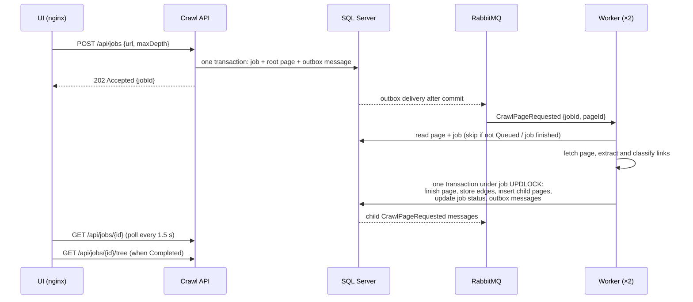

# Architecture

One page on layers, responsibilities and data flow. Design reasons are in [DECISIONS.md](DECISIONS.md).

## Projects and layers

| Project | Layer | Responsibility |
|---|---|---|
| `Crawler.Domain` | Domain (no dependencies) | Entities (`CrawlJob`, `CrawlPage`, `PageLink`), statuses, job transition rules, `UrlNormalizer`, `PageLinkAnalyzer`, `DomainLinkRatio`. Pure code, unit-tested. |
| `Crawler.Contracts` | Messages | `CrawlPageRequested(JobId, PageId)`, shared by API and Worker. |
| `Crawler.Infrastructure` | Infrastructure | `CrawlerDbContext`, EF Core mappings and migration, MassTransit + RabbitMQ setup with the EF Core outbox, DB health check. |
| `Crawler.Api` | Host (ASP.NET Core) | REST endpoints, request validation, job creation and cancel, read queries for the UI, migrations on startup (Docker/dev), Swagger. |
| `Crawler.Worker` | Host (ASP.NET Core, HTTP for health only) | Consumes page messages: fetch (HTTP resilience), parse links (AngleSharp), persist results, enqueue child pages. Health endpoints only. |
| `web/` | UI (React + Vite, nginx) | Start crawl, job details with polling and tree, history. nginx serves the static files and proxies `/api` to the API. |

Dependencies point inward: hosts → Infrastructure → Domain. The Domain has no reference to EF Core, MassTransit or HTTP.
Rules are decided in the Domain and applied atomically in SQL by Infrastructure/Worker code (ADR-003).

## Data flow

## Key points

1. **One message per page.** The message only identifies a page row; the database holds URL, depth and status.
   Any worker replica can take any page; RabbitMQ spreads the load (competing consumers).
2. **Job lifecycle:** `Pending` → `Running` (first page starts) → `Completed` (no `Queued` pages left), or `Failed`
   (root page failed or was not HTML), or `Canceled` (user). Progress is counted from `CrawlPages.Status`, not stored.
3. **Writes per job are serialized** by an `UPDLOCK` on the job row inside the consumer transaction. This makes
   de-duplication and the page budget race-free across replicas. Different jobs run in parallel.
4. **No row locks while fetching.** The page is downloaded before the job lock is taken. The consumer's outbox
   transaction (READ COMMITTED) is already open, so a connection is held during the fetch, bounded by the 45 s timeout
   and `ConcurrentMessageLimit` (8 per worker).
5. **Reads never block writes**: `READ_COMMITTED_SNAPSHOT` is on, so UI polling does not wait for worker locks.
6. **Failure isolation:** HTTP failures are recorded on the page; infrastructure failures are retried as messages;
   messages that still fail go to the error queue, and a fault consumer marks the page `Failed` so the job finishes.
